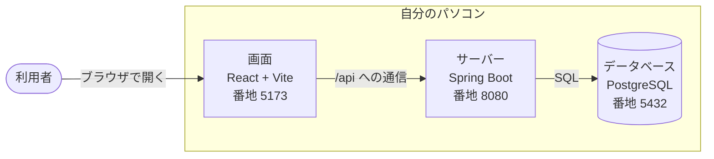

# タスク管理アプリ

Trello 風のタスク管理アプリ。タスクを「カード」として登録し、「未着手」「作業中」「完了」の3つのカラム（列）に並べて管理する。

スクールの課題として、Web アプリ開発を一通り経験するために作っている。要件定義、設計、実装、運用までを、自分の手で行う（[要件定義書](docs/要件定義書.md) 1章）。

- 利用者は自分1人。ログインはない
- 自分のパソコンで動かして開発する。AWS の上でも動かせる（[AWS で動かす](#aws-で動かす)）
- 誰でも使える形では、インターネットに公開しない。AWS で動かすときも、自分のパソコンの IP アドレスからだけ開ける

## 目次

- [今できていること](#今できていること)
- [構成](#構成)
- [使っている技術](#使っている技術)
- [動かすための準備](#動かすための準備)
- [起動のしかた](#起動のしかた)
- [停止のしかた](#停止のしかた)
- [コードの点検とテスト](#コードの点検とテスト)
- [テスト用のデータを入れる](#テスト用のデータを入れる)
- [うまく動かないとき](#うまく動かないとき)
- [AWS で動かす](#aws-で動かす)
- [フォルダの構成](#フォルダの構成)
- [文書](#文書)
- [開発の進め方](#開発の進め方)

## 今できていること

開発の途中である。バックアップ（書き出しと読み込み）のほかは、できている。

当初は「第1段階：ブラウザの `localStorage` に保存」「第2段階：データベースに保存」の2段階で作る計画だったが、第1段階は作らず、最初からデータベースに保存する形で作った（[要件定義書](docs/要件定義書.md) 1.4）。

| 番号 | 機能 | 状態 |
| --- | --- | --- |
| F-1 | ボードを表示する | できている（サーバーから読み込んで表示する） |
| F-2 | カードを追加する | できている |
| F-3 | カードを編集する | できている（ステータスの変更を含む） |
| F-4 | カードを削除する | できている |
| F-5 | ドラッグ＆ドロップで移動する | できている |
| F-6 | キーボードで操作する | できている |
| F-7 | 保存する | できている（データベースに保存する） |
| F-8 | バックアップする | まだ |
| F-9 | ボタンで並べ替える | できている |

機能ごとのくわしい要件は、[機能要件](docs/機能要件.md)に書いてある。

サーバーの窓口（API）は、7つのうち6つができている（[基本設計書](docs/基本設計書.md) 3章）。

| 方法 | 窓口 | 内容 | 状態 |
| --- | --- | --- | --- |
| GET | `/api/board` | ボード全体を返す | できている |
| POST | `/api/cards` | カードを追加する | できている |
| PUT | `/api/cards/{id}` | カードを更新する（ステータスの変更を含む） | できている |
| DELETE | `/api/cards/{id}` | カードを削除する | できている |
| PUT | `/api/cards/{id}/position` | カードを移動する | できている |
| PUT | `/api/columns/{key}/order` | カラムを並べ替える | できている |
| PUT | `/api/board` | ボード全体を置き換える | まだ |

完成したときの画面の見た目と動きは、見本（`mock/index.html`）をブラウザで開くと確かめられる。見本は、データを保存しない。

## 構成

画面、サーバー、データベースの3つに分かれている。3つとも、自分のパソコンの上で動く。



- ブラウザで開くのは、画面の番地 `http://localhost:5173` だけである
- 画面からの `/api` への通信は、Vite がサーバー（`http://127.0.0.1:8080`）へ取り次ぐ
- サーバーとデータベースは、同じパソコンからの接続だけを受け付ける

**番地（ポート）は、上の3つに固定している。** 別の番地で起動すると、画面とサーバーがつながらなくなる。

くわしい構成とデータの流れは、[基本設計書](docs/基本設計書.md)に書いてある。

AWS で動かすときは、同じ画面とサーバーを1台のサーバー（EC2）に置き、データベースは RDS を使う。インフラ構成図は [技術スタック](docs/技術スタック.md) 5章にある。

## 使っている技術

| 分類 | 使っているもの |
| --- | --- |
| 画面 | React 19、TypeScript 6、Vite 8 |
| サーバー | Java 25、Spring Boot 4.0.8、Gradle |
| データベース | PostgreSQL 18（Docker で動かす） |
| テーブルの変更の管理 | Flyway |
| コードの点検 | Oxlint（画面）、Checkstyle（サーバー）、GitHub Actions（プルリクエストごとに自動で点検） |
| 自動テスト | JUnit、Testcontainers（サーバーだけ） |
| AWS で動かす | EC2、RDS（PostgreSQL 18）、nginx、Terraform、AWS CLI |

選んだ理由と、選ばなかったものは、[技術スタック](docs/技術スタック.md)に書いてある。

## 動かすための準備

### パソコンに入れておくもの

| 入れるもの | 使いみち |
| --- | --- |
| [Node.js](https://nodejs.org/) | 画面を動かす |
| Java 25（[Eclipse Temurin](https://adoptium.net/)） | サーバーを動かす |
| [Docker Desktop](https://www.docker.com/products/docker-desktop/) | データベースを動かす |
| [Git](https://git-scm.com/) | 変更の履歴を管理する |

Gradle と PostgreSQL は、パソコンに直接は入れなくてよい。Gradle は `backend` に付いている `gradlew` が、PostgreSQL は Docker が用意する。

### 最初の1回だけ行うこと

コマンドは、PowerShell で実行する。

1. データベースの接続情報のファイルを作る。リポジトリの一番上のフォルダで、見本をコピーする。

   ```powershell
   Copy-Item .env.example .env
   ```

   できた `.env` を開き、`POSTGRES_PASSWORD` を、自分で決めたパスワードに書き換える。
   `.env` は、GitHub に上げない設定にしてある。

2. 画面に必要な部品を入れる。

   ```powershell
   cd frontend
   npm install
   ```

## 起動のしかた

データベース、サーバー、画面の順に起動する。サーバーと画面は、動かしている間ターミナルを使い続けるので、それぞれ別のターミナルで実行する。

1. Docker Desktop を起動しておく。

2. データベースを起動する（リポジトリの一番上のフォルダで）。

   ```powershell
   docker compose up -d
   ```

3. サーバーを起動する（1つめのターミナル）。

   ```powershell
   cd backend
   .\gradlew.bat bootRun
   ```

   `Started TaskmanagementApplication` と出たら、起動している。
   はじめて起動したときに、テーブルが自動で作られる（Flyway）。

4. 画面を起動する（2つめのターミナル）。

   ```powershell
   cd frontend
   npm run dev
   ```

5. ブラウザで <http://localhost:5173> を開く。ボード画面が表示される。

はじめて起動したときは、カードが1枚もない。未着手カラムの「＋ カードを追加」から追加する。まとめて表示を確かめたいときは、[テスト用のデータを入れる](#テスト用のデータを入れる)。

サーバーの記録（ログ）は、ターミナルに加えて `backend/logs/taskmanagement.log` にも残る。エラーが起きたときは、このファイルを見る。

## 停止のしかた

1. 画面とサーバーは、それぞれのターミナルで `Ctrl + C` を押す。

2. データベースを停止する（リポジトリの一番上のフォルダで）。

   ```powershell
   docker compose down
   ```

   停止しても、データベースの中身は残る。次に起動したときに、同じカードが見える。

## コードの点検とテスト

プルリクエストを作ると、GitHub Actions が下の点検を自動で行う（`.github/workflows/check.yml`）。プッシュする前に、手元でも実行しておくとよい。

画面側（`frontend` フォルダで実行する）

| コマンド | 内容 |
| --- | --- |
| `npm run check` | コードの点検（Oxlint）と、型のチェックをまとめて行う |
| `npm run lint` | コードを点検する（Oxlint）。警告が1つでもあれば失敗する |
| `npm run typecheck` | 型をチェックする |
| `npm run build` | 型のチェックをして、公開用のファイルを `dist/` に作る |

サーバー側（`backend` フォルダで実行する）

| コマンド | 内容 |
| --- | --- |
| `.\gradlew.bat check` | コードの点検（Checkstyle）、コンパイル、テストをまとめて行う |
| `.\gradlew.bat checkstyleMain checkstyleTest` | コードの点検だけを行う |
| `.\gradlew.bat test` | テストだけを行う |

テストは、Testcontainers が Docker で**テスト専用の**データベースを立ち上げて行う。ふだん使うデータベースには触らない。Docker Desktop を起動しておくこと（`docker compose up -d` は要らない）。

品質のチェックのくわしい観点は、スキル [quality-check](.claude/skills/quality-check/SKILL.md) にまとめてある。

## テスト用のデータを入れる

表示を確かめるためのカード6枚を、データベースに入れられる。データベースを起動した状態で、リポジトリの一番上のフォルダで実行する。

```powershell
docker cp db/testdata/insert_test_cards.sql taskmanagement-db:/tmp/insert_test_cards.sql
docker exec taskmanagement-db sh -c 'psql -U "$POSTGRES_USER" -d "$POSTGRES_DB" -f /tmp/insert_test_cards.sql'
```

何度実行しても、同じ結果になる。このファイルが入れるカードだけを入れ直すので、ほかのカードには触らない。

入れたあと、ブラウザで画面を再読み込みすると、カードが表示される。

## うまく動かないとき

| 起きていること | 確かめること |
| --- | --- |
| 画面に「サーバーにつながりません」と出る | サーバーが起動しているか。ブラウザで <http://localhost:5173/api/board> を開き、カードのデータ（`{"version":1,...` で始まる文字）が出るかを見る |
| 上を確かめても直らない | 画面（`npm run dev`）を `Ctrl + C` で止めて、起動し直す。画面を動かしたままブランチを切り替えると、サーバーへの取り次ぎが外れることがある |
| サーバーが起動の途中で止まる | データベースが起動しているか（`docker ps` に `taskmanagement-db` が出るか）。`.env` を作ったか |
| `Port 5173 is already in use` や `Port 8080 was already in use` と出る | 前に起動した画面やサーバーが、動いたままになっている。それを止めてから、起動し直す。別の番地では起動しない |

## AWS で動かす

同じアプリを、AWS（東京リージョン）の上でも動かせる。AWS の部品は Terraform のコード（`infra/`）で作り、アプリは PowerShell のスクリプト（`deploy/`）で載せる。マネジメントコンソール（AWS の Web 画面）は、アカウントの作成、ルートユーザーの保護、予算の設定にだけ使う。

| 知りたいこと | 書いてある場所 |
| --- | --- |
| インフラ構成図、部品ごとの設定、誰が何につながれるか、費用の目安 | [技術スタック](docs/技術スタック.md) 5章 |
| 構成の考え方（製品名を出さない図） | [基本設計書](docs/基本設計書.md) 1.4 |
| AWS の部品を作る・片付ける | [infra/README.md](infra/README.md) |
| アプリを載せる・前の版に戻す・動作を確かめる・データを残す | [deploy/ec2/README.md](deploy/ec2/README.md) |

### 準備（最初の1回だけ）

1. **AWS アカウント**：ルートユーザー（アカウントを作ったときのメールアドレスとパスワード）に MFA を登録し、ルートユーザーのアクセスキーは作らない。月額の予算を決め、超えそうなときにメールが届くようにする（AWS Budgets）
2. **道具**：AWS CLI と Terraform を入れる（`winget install --id Amazon.AWSCLI -e --source winget`、`Hashicorp.Terraform` も同じ）。入れたら Cursor を開き直す。版は [技術スタック](docs/技術スタック.md) 4.4
3. **ログイン**：今は IAM ユーザーのアクセスキー（MFA あり）を `aws configure` で登録して使っている。`aws sts get-caller-identity` で確かめる。期限のない鍵なので、いずれ IAM Identity Center（一時的な鍵）に切り替える
4. **AWS の部品を作る**：SSH の鍵、Terraform の記録の置き場所、自分の IP アドレスを用意して、`terraform apply` する（[infra/README.md](infra/README.md)）
5. **アプリを載せる**：`.\deploy\deploy.ps1`（[deploy/ec2/README.md](deploy/ec2/README.md)）

Norton の「セーフウェブ」が暗号化された通信を点検していると、AWS CLI は証明書のエラーで、Terraform は「Plugin did not respond」で止まる。セーフウェブの除外に、`amazonaws.com`、`127.0.0.1`、`localhost`、`registry.terraform.io`、`releases.hashicorp.com` を登録する。

### 日々の運用

| やりたいこと | すること | 手順 |
| --- | --- | --- |
| 変えたものを載せる | main で `.\deploy\deploy.ps1`（画面だけなら `-Frontend`、サーバーだけなら `-Backend`） | [deploy/ec2/README.md](deploy/ec2/README.md) |
| 載せた版がおかしい | `.\deploy\deploy.ps1 -Rollback`（動かない版は、載せたときに自動で戻る） | [deploy/ec2/README.md](deploy/ec2/README.md) |
| 動いているか確かめる | `.\deploy\smoke-test.ps1` と、ブラウザで触る確認の一覧 | [deploy/ec2/README.md](deploy/ec2/README.md) |
| 使わない日は止める・また動かす | EC2 と RDS を止める・動かす。動かしたあと `terraform apply -refresh-only` で、新しい IP アドレスを記録する | [infra/README.md](infra/README.md) |
| 自宅の IP アドレスが変わった | `infra/terraform.tfvars` の `my_ip` を直して `terraform apply` | [infra/README.md](infra/README.md) |
| RDS のパスワードが変わった（7 日ごと） | 自動で Spring Boot を起動し直す。つながらないときだけ手で起動し直す | [deploy/ec2/README.md](deploy/ec2/README.md) |
| データを残す・戻す | EC2 で `pg_dump` し、パソコンに持ってくる | [deploy/ec2/README.md](deploy/ec2/README.md) |
| 課題が終わった | `terraform destroy` で全部消す（RDS の中身も消える） | [infra/README.md](infra/README.md) |

### 守ること

- アクセスキー、パスワード、SSH の秘密鍵を、リポジトリにもチャットにも書かない。リポジトリは公開なので、AWS のアカウント番号と自分の IP アドレスも書かない
- `terraform apply` と `terraform destroy` は、`terraform plan` を確かめてからにする。plan に `-`（消す）や `-/+`（消して作り直す）が出たら、止まって理由を確かめる
- Terraform で作ったものの設定を、マネジメントコンソールや AWS CLI で直接変えない（止める・動かすのはよい）
- デプロイは main から `deploy.ps1` で行う

## フォルダの構成

```text
taskmanegemento/
├── backend/            サーバー（Java、Spring Boot）
│   ├── config/checkstyle/  コードの点検（Checkstyle）のルール
│   ├── logs/           サーバーの記録（起動すると作られる。GitHub には上げない）
│   └── src/
│       ├── main/
│       │   ├── java/       サーバーのプログラム
│       │   └── resources/
│       │       ├── application.properties   サーバーの設定
│       │       └── db/migration/            テーブルを作る SQL（Flyway が実行する）
│       └── test/       サーバーのテスト
├── frontend/           画面（React、TypeScript、Vite）
│   ├── src/
│   │   ├── components/        画面の部品（カラム、カード、追加フォーム、ダイアログ、お知らせ欄）
│   │   ├── repository/        保存係（サーバーとの通信）
│   │   ├── useBoard.ts        ボードの読み込みと保存
│   │   ├── boardOperations.ts ボードのデータを変える関数
│   │   └── App.tsx            画面の全体
│   ├── .oxlintrc.json    コードの点検（Oxlint）のルール
│   └── vite.config.ts    番地と、サーバーへの取り次ぎの設定
├── infra/              AWS の部品を作る Terraform のコード
│   ├── versions.tf         Terraform と AWS provider の版、記録（state）の置き場所
│   ├── variables.tf        外から渡す値（自分の IP アドレスなど）
│   ├── network.tf          EC2 のセキュリティグループ（つなげる相手の決まり）
│   ├── compute.tf          EC2 と SSH の公開鍵
│   ├── user_data.sh        EC2 が初めて起動したときに、Java と nginx を入れる
│   ├── database.tf         RDS と、そのセキュリティグループ
│   ├── iam.tf              EC2 の権限（RDS のパスワードを読むことだけ）
│   ├── outputs.tf          作ったあとに表示する値（URL、SSH のコマンドなど）
│   ├── terraform.tfvars.example  自分の IP アドレスを書くファイルの見本
│   └── .terraform.lock.hcl       provider の版を固定する記録
├── deploy/             AWS にアプリを載せるスクリプト
│   ├── deploy.ps1          点検、ビルド、送る、入れ替える、確かめる（パソコンで動かす）
│   ├── smoke-test.ps1      載せたあとの動作の確認
│   └── ec2/                EC2 に置くもの（nginx の設定、Spring Boot の起動、入れ替え、パスワードの見張り）
├── .github/            プルリクエストのひな形と、自動の点検（GitHub Actions）の設定
├── .claude/skills/     Claude Code のスキル（サーバーの起動、品質のチェック）
├── db/testdata/        テスト用のデータを入れる SQL
├── docs/               要件定義と設計の文書
├── mock/               画面の見本（HTML、CSS、JavaScript だけで動く）
├── compose.yaml        データベースを動かす設定
├── .env.example        データベースの接続情報の見本
├── .gitattributes      EC2 で動かすファイルの改行を LF に固定する設定
└── CLAUDE.md           開発の進め方のルール
```

## 文書

要件定義と設計の文書は、`docs/` にそろえてある。全体をつかむには、要件定義書から読むとよい。

| 文書 | 内容 |
| --- | --- |
| [要件定義書](docs/要件定義書.md) | アプリの概要、目的、対象範囲、制約とリスク |
| [機能要件](docs/機能要件.md) | 機能の一覧、利用者ができること、操作の流れ、機能ごとの要件 |
| [非機能要件](docs/非機能要件.md) | 動作環境、性能、データの保全、運用、使いやすさ、セキュリティ、保守性 |
| [画面設計](docs/画面設計.md) | 画面の一覧、画面の移り方、画面ごとの項目、入力のチェック |
| [データ設計](docs/データ設計.md) | カードとボードのデータの形、ER図、テーブルの定義 |
| [基本設計書](docs/基本設計書.md) | システム構成、データの流れ、サーバーの窓口（API） |
| [技術スタック](docs/技術スタック.md) | 使う技術と選んだ理由、選ばなかった技術 |
| [受け入れ条件](docs/受け入れ条件.md) | 完成したかを確かめる条件 |

AWS で動かすための手順は、コードと同じフォルダに置いてある。

| 文書 | 内容 |
| --- | --- |
| [infra/README.md](infra/README.md) | AWS の部品を作る・止める・動かす・片付ける手順 |
| [deploy/ec2/README.md](deploy/ec2/README.md) | アプリを載せる、前の版に戻す、動作を確かめる、データを残す手順 |

自分のパソコンのデータベースのバックアップと復元の手順書は、まだ作っていない。AWS のデータベース（RDS）の手順は、[deploy/ec2/README.md](deploy/ec2/README.md) にある。

## 開発の進め方

変更は、必ず次の順番で行う。main ブランチには、直接プッシュできない設定にしてある。

1. イシューを作る
2. イシューの番号を入れたブランチを、main から作る（例：`feature/12-task-list-screen`）
3. ブランチの上で変更し、コミットする
4. プルリクエストを作る
5. 確認して、main に取り込む

くわしいルール（イシュー、ブランチ、コミット、プルリクエストの書き方）は、[CLAUDE.md](CLAUDE.md) に書いてある。
