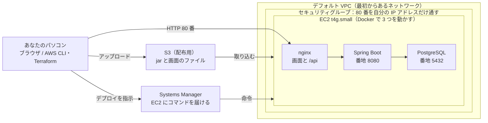

# AWS × Terraform デプロイ入門ガイド（taskmanegemento）

作成日：2026-10-27

## はじめに

このガイドのゴールは、taskmanegemento を「画面を手でクリックせず、コマンドと Terraform のコードだけで」AWS に載せられるようになることです。AWS も Terraform もはじめての人を読者として、用語の意味から順に説明します。

進め方は大きく3段階です。

1. **知る**：AWS、IaC、Terraform、AWS CLI が何なのかをつかむ（基礎知識の3章）
2. **準備する**：AWS アカウントを安全に作り、自分のパソコンから AWS を操作できるように認証を設定する（手順1〜3）
3. **作る**：Terraform でサーバーやデータベースを作り、アプリを載せ、最後に片付ける（手順4〜6）

マネジメントコンソール（AWS の Web 画面）は、アカウントを作る・ルートユーザーを守る・最初の認証の土台を作る、の3つだけ使います。ここだけはコマンドでできないか、コマンドでやると危ないためです。それ以外はすべて AWS CLI と Terraform で行い、Claude Code にコマンドを書かせて、あなたが内容を確かめてから実行します。

費用について：このアプリは自分だけが使うスクールの課題なので、無料プランの範囲で収まるように EC2 1 台にまとめた構成にしています（手順4）。それでも AWS は使った分だけお金がかかるので、手順1の「請求アラート」を先に設定し、使わない日は止め、課題が終わったら手順6の「片付け」で消してください。

## 基礎知識① AWS とは

AWS（Amazon Web Services）は、サーバーやデータベースを「必要なときに、必要なぶんだけ」借りられるサービスです。このような仕組みを**クラウド**といいます。自分でサーバーの機械を買う代わりに、時間や量に応じて利用料を払います。

今は、あなたのパソコンの中で画面（Vite）・サーバー（Spring Boot）・データベース（Docker の PostgreSQL）が動いています。AWS にデプロイするとは、この3つを AWS の部品に置き換えて、インターネットから使えるようにすることです。

このガイドで使う AWS の部品（サービス）は次のとおりです。

| サービス | ひとことで言うと | このアプリでの役目 |
| --- | --- | --- |
| IAM | 「誰が、何をしてよいか」を決める仕組み | あなたや Terraform、EC2 が AWS を操作するための許可 |
| リージョン | AWS のデータセンターがある地域 | 東京（`ap-northeast-1`）を使う |
| VPC | AWS の中の、自分専用のネットワーク | アカウントに最初からある「デフォルト VPC」をそのまま使う |
| セキュリティグループ | 部品ごとの門番（ファイアウォール） | 80 番を、あなたの IP アドレスからだけ通す |
| EC2 | 仮想のサーバー（パソコン）を借りるサービス | Docker で画面・Spring Boot・PostgreSQL をまとめて動かす |
| EBS | EC2 につなぐディスク | データベースの中身を残す |
| S3 | ファイル置き場 | パソコンで作った jar と画面のファイルを EC2 に渡す。Terraform の記録ファイルも置く |
| Systems Manager（SSM） | EC2 にコマンドを届ける仕組み | SSH の鍵なしで、デプロイの命令やログの確認をする |
| AWS Budgets | 予算と請求の見張り | 使いすぎたときにメールで知らせる |

全部をいっぺんに覚える必要はありません。手順4の構成図で、これらがどうつながるかを絵で確かめられます。仕事でよく使う RDS、ECS、CloudFront などは、費用がかかるので今回は使いません。

## 基礎知識② IaC と Terraform とは

**IaC**（Infrastructure as Code）は、サーバーやネットワークの構成を「コードとしてファイルに書く」やり方です。画面をクリックして作ると、何をどう設定したかが記憶にしか残りません。コードにしておくと、次のような良いことがあります。

- **同じものを何度でも作れる**：消しても、コマンド1つで元どおりに作り直せる
- **変更の履歴が Git に残る**：アプリのコードと同じく、イシュー → ブランチ → プルリクエストでレビューできる
- **AI と相性がいい**：Claude Code がファイルを書き、あなたが差分を読んで確かめる、という分担ができる

**Terraform** は、HashiCorp 社が作った IaC の道具です。`.tf` というファイルに「こういう状態にしてほしい」を書くと、Terraform が今の状態との差を調べ、足りないものを作り、違うものを直し、余ったものを消します。この書き方を**宣言的**といいます（手順ではなく、ゆきつく先を書く）。

たとえば、ファイル置き場（S3 バケット）を1つ作るコードはこうなります。

```hcl
# どのクラウドを、どの地域で使うか
provider "aws" {
  region = "ap-northeast-1"
}

# 作りたいもの（リソース）
resource "aws_s3_bucket" "frontend" {
  bucket = "taskmanagement-frontend-example"
}
```

覚えておく言葉は次の6つです。

| 言葉 | 意味 |
| --- | --- |
| provider | どのクラウド（ここでは AWS）と話すかを決める部品 |
| resource | 作りたいもの1つ（バケット、データベースなど） |
| variable / output | 外から渡す値 / 作った後に表示したい値（URL など） |
| module | いくつかの resource をまとめた部品。だんだん使えばよい |
| state（ステート） | Terraform が「自分が作ったものの一覧」を記録したファイル。これを失うと、Terraform は自分が作ったものを忘れてしまう |
| backend | state の置き場。このガイドでは S3 に置く |

使うコマンドは、ほぼ次の4つだけです。

1. `terraform init`：準備。provider をダウンロードし、backend につなぐ
2. `terraform plan`：**下見**。何を作り、変え、消すかを表示するだけで、何も変えない
3. `terraform apply`：**実行**。plan の内容を本当に反映する。`yes` と打つまでは動かない
4. `terraform destroy`：**片付け**。Terraform が作ったものをすべて消す

plan の結果には、`+`（作る）、`~`（変える）、`-`（消す）、`-/+`（消して作り直す）の印がつきます。**`-` と `-/+` が出たら必ず止まって理由を確かめる**、これが一番大事な習慣です。データベースが作り直されると、中のデータは消えます。

## 基礎知識③ AWS CLI と、AI を使った進め方

**AWS CLI** は、AWS をコマンドで操作するための道具です。マネジメントコンソールでできることは、ほぼすべて `aws サービス名 操作名` の形のコマンドでもできます。

```powershell
# 今、自分が誰として AWS につながっているかを表示する
aws sts get-caller-identity

# S3 のバケットの一覧を表示する
aws s3 ls
```

AWS CLI と Terraform は、役割を分けて使います。

| 道具 | 使う場面 | 例 |
| --- | --- | --- |
| Terraform | **作って残しておくもの**を作る・変える・消す | EC2、セキュリティグループ、S3 バケット |
| AWS CLI | 認証、状態の確認、アプリの中身の入れ替え | ログイン、ログを見る、画面のファイルを S3 に上げる |

AWS CLI でデータベースなどを直接作ったり変えたりすると、Terraform の記録とずれます（これを**ドリフト**といいます）。残すものは Terraform、それ以外は AWS CLI、という線引きを守ります。

### Claude Code との分担

Claude Code は、あなたのパソコンの上で、あなたと同じ権限でコマンドを実行します。つまり、あなたが AWS にログインしていれば、Claude Code も AWS を操作できます。便利な反面、間違ったコマンドでも実際に動いてしまうので、次のように分担します。

| 作業 | Claude Code | あなた |
| --- | --- | --- |
| `.tf` ファイルを書く | 書く | プルリクエストで差分を読む |
| `terraform plan`、状態を見る `aws` コマンド | 実行して結果を説明する | 説明を読む |
| `terraform apply`、`terraform destroy` | コマンドを提示する | plan を確かめて、自分で許可・実行する |
| ルートユーザーや支払いの設定 | 触らない | マネジメントコンソールで行う |

Claude Code はコマンドを実行する前に許可を求めてきます。`terraform apply` や `aws ... delete-...` の許可を求められたら、「何が変わるのか」を聞いてから許可してください。「常に許可」には、読むだけのコマンド（`plan`、`describe-...`、`list-...`、`get-...`）だけを入れます。

## 手順1 AWS アカウントを作り、ルートユーザーを守る

この手順だけはマネジメントコンソール（ブラウザ）で行います。約20分です。

**ルートユーザー**とは、アカウントを作ったときのメールアドレスとパスワードのことです。支払いも解約も含めて何でもできるため、盗まれると大きな請求につながります。ふだんの作業には使わず、金庫の鍵のようにしまっておきます。

1. <https://aws.amazon.com/> で「アカウントを作成」を選び、メールアドレス、アカウント名、クレジットカード、電話番号を登録する
2. プランを選ぶ。新しいアカウントには最大 200 ドル分のクレジット（無料分）がつきます（[AWS 無料利用枠](https://aws.amazon.com/free/)）
    1. **無料プラン**：請求は来ない。ただし使えるサービスが限られ、6か月かクレジットを使い切った時点でアカウントが閉じる
    2. **有料プラン**：すべてのサービスが使える。クレジットを超えた分は請求される
    3. まず無料プランで始め、Terraform が「このサービスは使えない」というエラーを出したら有料プランに切り替えるのが安全です
3. ルートユーザーでサインインし、右上のアカウント名 →「セキュリティ認証情報」で **MFA（多要素認証）** を登録する。スマートフォンの認証アプリか、パスキーを使う
4. 同じ画面で、ルートユーザーの**アクセスキーが1つもない**ことを確かめる。作らない
5. 「請求とコスト管理」→「Budgets」で、月 10 ドルなどの予算を作り、超えそうなときにメールが届くようにする（「月次コスト予算」のひな形でよい）

ここまで終わったら、ルートユーザーは次の手順2でしか使いません。

## 手順2 Windows に AWS CLI と Terraform を入れる

Windows に最初から入っている `winget`（アプリを入れるコマンド）を使います。PowerShell で次を実行します。ここは Claude Code に「入れて」と頼んでもかまいません。

```powershell
winget install --id Amazon.AWSCLI -e
winget install --id Hashicorp.Terraform -e
```

入れたら、**Cursor をいったん閉じて開き直し**（新しいコマンドの場所を読み直すため）、入ったことを確かめます。

```powershell
aws --version
terraform version
```

版の番号が表示されれば成功です。入った版は、あとで `docs/技術スタック.md` の4.4章に書き足します。Docker Desktop は、サーバーのイメージを作るときに使います（すでに入っています）。

## 手順3 認証を設定する（IAM Identity Center）

自分のパソコンから AWS を操作するには、「自分が誰か」を AWS に証明する必要があります。このガイドでは **IAM Identity Center** を使い、ブラウザでログインして**数時間で切れる一時的な鍵**をもらう方式にします。

よく見かける「IAM ユーザーのアクセスキーを `aws configure` で登録する」方法は使いません。アクセスキーは期限のない鍵で、誤って GitHub に上げると数分で悪用され、高額な請求になる事故が実際に起きています。

### 3-1 マネジメントコンソールで土台を作る（最初の1回だけ）

ルートユーザーでサインインし、右上のリージョンを「東京」にしてから進めます。

1. 「IAM Identity Center」を開き、「有効にする」を選ぶ（「AWS Organizations で有効にする」でよい）
2. 「ユーザー」で、作業用のユーザー（例：`junji`）を作る。招待メールが届く
3. 「許可セット」で、事前定義の `AdministratorAccess` を作る。「セッションの期間」は 4 時間にする
4. 「AWS アカウント」で自分のアカウントを選び、「ユーザーまたはグループを割り当てる」で、作ったユーザーと許可セットを結びつける
5. ダッシュボードに表示される **AWS アクセスポータルの URL**（`https://d-xxxxxxxxxx.awsapps.com/start` の形）を控える
6. ルートユーザーからサインアウトし、招待メールからパスワードと MFA を設定する

`AdministratorAccess` は強い権限です。Terraform が「サーバーが使う権限（IAM ロール）」も作るため、学習ではこれを使います。その代わり、セッションを短くし、MFA を必ずつけます。

### 3-2 AWS CLI にログインの設定を登録する（最初の1回だけ）

```powershell
aws configure sso
```

質問には次のように答えます。途中でブラウザが開くので、ログインして「許可」を押します。

| 質問 | 答え |
| --- | --- |
| SSO session name | `taskmanagement` |
| SSO start URL | 3-1 の 5 で控えた URL |
| SSO region | `ap-northeast-1` |
| SSO registration scopes | 何も入れず Enter |
| アカウントとロールの選択 | 自分のアカウントと `AdministratorAccess` |
| Default client Region | `ap-northeast-1` |
| CLI default output format | `json` |
| Profile name | `taskmanagement` |

答えた内容は、`C:\Users\あなたの名前\.aws\config` に**プロファイル**（接続の設定のまとまり）として保存されます。このファイルにパスワードや鍵は入りません。

### 3-3 つながったことを確かめる

```powershell
aws sts get-caller-identity --profile taskmanagement
```

`Account`（12桁の番号）と `Arn`（`AWSReservedSSO_AdministratorAccess` を含む）が表示されれば成功です。

### 3-4 毎日の使い方

作業を始めるときに、PowerShell で次の2行を実行します。鍵は数時間で切れるので、切れたら 1 行目をもう一度実行します。

```powershell
aws sso login --profile taskmanagement
$env:AWS_PROFILE = "taskmanagement"
```

2 行目で、その PowerShell の中では `--profile` を省けるようになります。Terraform も同じ設定を読むため、Terraform のコードに鍵を書く必要はありません。Claude Code に作業を頼むときは、「`taskmanagement` プロファイルを使って」と伝えます。

## 手順4 このアプリの AWS 構成と費用の目安

このアプリは自分だけが使うスクールの課題なので、**EC2（仮想のサーバー）1 台に全部をまとめる**構成にします。今パソコンで Docker を使っているのと同じように、EC2 の中で画面・Spring Boot・PostgreSQL を Docker で動かします。無料プランのクレジットの範囲で収まり、カードに請求は来ません。



データは EC2 のディスク（EBS 20GB）に残ります。

アプリを開けるのは、あなたのパソコンの IP アドレスからだけです。ログインがないアプリでも、他人には書き換えられません。プログラムはパソコンで作って S3 に上げ、Systems Manager で EC2 に「取り込んで入れ替えて」と命令します。SSH の鍵も、開けておく番地（22 番）もいりません。

今のパソコンの中の部品は、次のように置き換わります。

| 今（パソコン） | AWS（EC2 の中） |
| --- | --- |
| Vite（画面、番地 5173） | `npm run build` で作った `frontend/dist` を、nginx が番地 80 で配る |
| Vite のプロキシ（`/api` を取り次ぐ） | nginx が `/api` を Spring Boot へ取り次ぐ |
| Spring Boot（番地 8080） | パソコンで作った jar を、Java 25 の公式イメージで動かす（番地は 8080 のまま） |
| Docker の PostgreSQL 18（番地 5432） | 同じ `postgres:18` イメージ。データは EC2 のディスク（EBS）に残る |
| `.env` のパスワード | EC2 が初めて起動したときに自分で作り、EC2 の中の `.env` にだけ置く |

無料の対象になる型（大きさ）は、このアカウントでは t3.micro、t3.small、t4g.micro、t4g.small などです。Spring Boot と PostgreSQL を一緒に動かすにはメモリが 2GB ほしいので、**t4g.small** を使います。t4g.small は 2026-12-31 まで、月 750 時間（つまり 1 台をずっと）無料で動かせます（[Amazon EC2 T4g](https://aws.amazon.com/ec2/instance-types/t4/)）。

### 費用の目安

動かしっぱなしにしても **月およそ 6 ドル**で、これは無料プランのクレジット（残り 100 ドル）から差し引かれます。金額はどれも東京リージョンの概算です。

| 部品 | 月額の目安（概算、ドル） |
| --- | --- |
| EC2 t4g.small | 0（2026-12-31 までの無料トライアル。その後は約 15） |
| 公開 IP アドレス 1 つ | 約 3.6（EC2 を止めているあいだはかからない） |
| EBS（ディスク 20GB） | 約 2 |
| S3（state と配布用）、Systems Manager | ほぼ 0 |

節約のコツは2つです。

- 使わない日は EC2 を**止める**（手順6-4）。データは残り、残る費用はディスク代の月約 2 ドルだけ
- 課題が終わったら `terraform destroy` で**片付ける**。費用はほぼ 0 になる

t4g は、負荷が高い状態が続くと追加料金がかかる設定が初期値です。Terraform で `cpu_credits = "standard"` を指定し、追加料金が出ないようにします。

### 使わないもの

仕事の Web アプリでよく使う次のサービスは、便利ですが月に数十ドルかかるので、今回は使いません。

| 使わないもの | 代わり |
| --- | --- |
| RDS（データベース専用のサービス） | EC2 の中の PostgreSQL |
| ECS・ECR（コンテナ専用のサービス） | EC2 の中の Docker と、Docker の公式イメージ |
| ALB（ロードバランサー）、CloudFront | nginx |
| 新しい VPC、NAT ゲートウェイ | 最初からあるデフォルト VPC |
| Secrets Manager | EC2 の中の `.env` |

### アプリのコードは変えなくてよい

必要な変更は、EC2 での起動の設定だけで済みます。新しく `deploy` フォルダを作り、EC2 用の `compose.yaml` と nginx の設定を置きます。

1. **受け付ける範囲**：今は `server.address=127.0.0.1`（同じパソコンからだけ）。コンテナの中では nginx からの接続を受ける必要があるので、環境変数 `SERVER_ADDRESS=0.0.0.0` で上書きする。番地（8080）は変えない
2. **データベースの場所**：今は `localhost:5432`。環境変数 `SPRING_DATASOURCE_URL` で、同じ EC2 の中の PostgreSQL コンテナを指す
3. **文書**：`docs/非機能要件.md` 6章の「同じパソコンからだけつなぐ」に、「AWS では自分の IP アドレスからだけつなぐ」を書き足す

## 手順5 Terraform の土台を作り、少しずつ構築する

### 5-1 state の置き場を作る（最初の1回だけ、AWS CLI で）

Terraform の記録（state）は、パソコンが壊れても失わないように S3 に置きます。このバケットだけは、Terraform 自身の記録を入れる場所なので、Terraform より先に AWS CLI で作ります。

```powershell
# 自分のアカウント番号を取り出し、世界で重ならないバケット名を作る
$account = aws sts get-caller-identity --query Account --output text
$bucket = "taskmanagement-tfstate-$account"

# バケットを作る
aws s3api create-bucket --bucket $bucket --region ap-northeast-1 --create-bucket-configuration LocationConstraint=ap-northeast-1

# 上書きしても前の版に戻せるようにする
aws s3api put-bucket-versioning --bucket $bucket --versioning-configuration Status=Enabled

# インターネットに公開されないようにする
aws s3api put-public-access-block --bucket $bucket --public-access-block-configuration BlockPublicAcls=true,IgnorePublicAcls=true,BlockPublicPolicy=true,RestrictPublicBuckets=true
```

Terraform からは、このバケットを backend として指定します。`use_lockfile = true` は、同時に2つの apply が走らないように鍵をかける設定です（[Terraform の S3 backend](https://developer.hashicorp.com/terraform/language/backend/s3)）。古い解説にある DynamoDB で鍵をかける方法は、今は非推奨です。

```hcl
terraform {
  backend "s3" {
    bucket       = "taskmanagement-tfstate-123456789012" # 自分のバケット名
    key          = "taskmanagement/terraform.tfstate"
    region       = "ap-northeast-1"
    use_lockfile = true
  }
}
```

### 5-2 フォルダの構成

リポジトリに `infra` フォルダを作り、役割ごとにファイルを分けます。Terraform はフォルダの中の `.tf` を全部まとめて読むので、分け方は自由です。

| ファイル | 中身 |
| --- | --- |
| `infra/versions.tf` | Terraform と AWS provider の版、backend の設定 |
| `infra/variables.tf` | リージョン、あなたの IP アドレス（`my_ip`）など、外から渡す値 |
| `infra/network.tf` | デフォルト VPC の読み取りと、セキュリティグループ（80 番を `my_ip` からだけ） |
| `infra/iam.tf` | EC2 に渡す権限（Systems Manager を使う、配布用 S3 を読む） |
| `infra/storage.tf` | 配布用の S3 バケット |
| `infra/compute.tf` | EC2（t4g.small、`cpu_credits = "standard"`、ディスク 20GB）。起動時に Docker を入れる手順（user data）もここに書く |
| `infra/outputs.tf` | 作った後に表示する値（`app_url`、`instance_id`、`artifact_bucket`） |
| `infra/.terraform.lock.hcl` | provider の版を固定する記録。`terraform init` が作る。**Git に入れる** |
| `deploy/compose.yaml` | EC2 の中で動かす 3 つのコンテナ（nginx、Spring Boot、PostgreSQL） |
| `deploy/nginx.conf` | 画面を配り、`/api` を Spring Boot へ取り次ぐ設定 |

`.gitignore` には `infra/.terraform/`、`*.tfstate`、`*.tfstate.*`、`*.tfvars` を足し、state や秘密が GitHub に上がらないようにします。

### 5-3 1回分の流れ（このプロジェクトのルールに合わせて）

Terraform のコードもアプリのコードと同じく、`CLAUDE.md` の「イシュー → ブランチ → プルリクエスト」の流れに乗せます。

1. イシューを作る（例：「Terraform で state の置き場と土台を作る」、ラベル `enhancement`）
2. ブランチを作る（例：`chore/40-terraform-base`）
3. Claude Code が `.tf` を書き、`terraform fmt`（書き方をそろえる）と `terraform validate`（文法の確認）を通す
4. `terraform plan` を実行し、結果の要点をプルリクエストの本文に書く
5. あなたがプルリクエストと plan を確かめて、main に取り込む
6. main に切り替えて最新にし、もう一度 `terraform plan` で同じ内容か確かめてから `terraform apply` を実行する

### 5-4 作る順番

一度に全部作らず、次の順に1つずつイシューにして進めます。途中で失敗しても、どこでつまずいたかが分かりやすくなります。

1. state の置き場（5-1）と `infra/versions.tf`
2. セキュリティグループ、EC2 の権限、配布用 S3（`network.tf`、`iam.tf`、`storage.tf`）
3. EC2 本体（`compute.tf`）。Systems Manager から EC2 につながることまで確かめる
4. EC2 で動かす設定（`deploy/compose.yaml`、`deploy/nginx.conf`）と、初めてのデプロイ（手順6）
5. 文書の更新（`docs/非機能要件.md` 6章、`docs/技術スタック.md`）

## 手順6 アプリを載せて確かめ、片付ける

Terraform が作るのは EC2 などの「入れ物」です。中身（jar と画面のファイル）は、パソコンで作って S3 に上げ、Systems Manager で EC2 に取り込ませます。EC2 には、初めて起動したときに次の 2 つの手順書（スクリプト）を置いておきます。中身は Terraform の `compute.tf` に書きます。

- `/opt/taskmanagement/deploy.sh`：S3 から取り込み、Docker で 3 つを動かし直す
- `/opt/taskmanagement/logs.sh`：Spring Boot のログの最後の 50 行を表示する

### 6-1 パソコンで作って S3 に上げる

```powershell
# 画面をビルドする（frontend/dist ができる）
npm --prefix frontend run build

# サーバーをビルドする（backend/build/libs に jar ができる）
.\backend\gradlew.bat -p backend bootJar

# 配布用の S3 に上げる
$bucket = terraform -chdir=infra output -raw artifact_bucket
aws s3 sync frontend/dist "s3://$bucket/dist" --delete
aws s3 cp backend/build/libs/taskmanagement-0.0.1-SNAPSHOT.jar "s3://$bucket/app.jar"
aws s3 sync deploy "s3://$bucket/deploy" --delete
```

jar は Java の上で動くので、あなたのパソコン（Intel や AMD の CPU）で作ったものが、そのまま EC2（Arm の CPU）で動きます。Docker イメージを自分で作る必要もありません。

### 6-2 EC2 に入れ替えを命令する

```powershell
$id = terraform -chdir=infra output -raw instance_id

# deploy.sh を実行させる
$cmd = aws ssm send-command --instance-ids $id --document-name AWS-RunShellScript --parameters "commands=/opt/taskmanagement/deploy.sh" --query Command.CommandId --output text

# 結果を見る（Success と出れば完了。InProgress なら少し待ってもう一度）
aws ssm get-command-invocation --command-id $cmd --instance-id $id --query "[Status,StandardOutputContent]" --output text
```

テーブルは、Spring Boot が起動するときに Flyway が自動で作ります。今と同じ仕組みなので、手で SQL を流す必要はありません。

### 6-3 動いているか確かめる

| 確かめること | やり方 |
| --- | --- |
| アプリの URL | `terraform -chdir=infra output app_url` で表示された URL をブラウザで開く |
| EC2 が動いているか | `aws ec2 describe-instances --instance-ids $id --query "Reservations[0].Instances[0].State.Name" --output text`（`running` なら動いている） |
| サーバーのログ | 6-2 の `deploy.sh` を `logs.sh` に変えて実行し、結果を見る |
| 窓口（API）が答えるか | ブラウザで `アプリの URL/api/board` を開き、JSON が返るか見る |

画面が出て、カードを足して再読み込みしても残っていれば、デプロイは成功です。うまくいかないときは、ログを Claude Code に読ませて原因を聞きます。

自宅の IP アドレスは、ルーターの再起動などで変わることがあります。急に画面が開かなくなったら、`(Invoke-RestMethod https://checkip.amazonaws.com).Trim()` で今の IP アドレスを調べ、`my_ip` を直して `terraform apply` します。

### 6-4 使わない日は止める

```powershell
# 止める
aws ec2 stop-instances --instance-ids $id

# また動かす
aws ec2 start-instances --instance-ids $id

# 動かした後の公開 IP アドレスを調べる（http://そのアドレス/ を開く）
aws ec2 describe-instances --instance-ids $id --query "Reservations[0].Instances[0].PublicIpAddress" --output text
```

止めてもデータはディスクに残り、動かすと 3 つのコンテナも自動で立ち上がります。ただし、公開 IP アドレスは動かすたびに変わります。固定する方法（Elastic IP）もありますが、止めているあいだも費用がかかるので使いません。

### 6-5 片付ける

課題が終わったら、費用を止めるために全部消します。

```powershell
terraform -chdir=infra destroy
```

消すものの一覧が出るので、確かめてから `yes` と打ちます。**EC2 のディスクも消えるので、データベースの中身も消えます。** 残したいときは、先に `pg_dump` で書き出しておきます。配布用の S3 は、ファイルが残っていても消せるように `force_destroy = true` にしておきます。

state 用のバケット（5-1）は Terraform の外で作ったので、`destroy` では消えません。費用は月に 1 円にも満たないので、続けて使うなら残しておきます。

慣れてきたら、6-1 と 6-2 を GitHub Actions で自動化できます（鍵を GitHub に置かない OIDC という方式を使います）。これは別のイシューで扱います。

## 安全のためのルールと、Claude Code への頼み方

### 守るルール

- アクセスキーを作らない。パスワードや鍵を `.tf`、`.md`、コミットに書かない
- `terraform apply` と `terraform destroy` は、plan を自分の目で確かめてから、自分で許可する
- plan に `-` か `-/+` が出たら止まって理由を聞く
- Terraform で作ったものを、マネジメントコンソールや AWS CLI で直接変えない（ドリフトの原因になる）
- 練習が終わったら `terraform destroy`。予算のメールが来たら、まずこれを実行する
- `.claude/settings.json` の「常に許可」には、読むだけのコマンドだけを入れる。`terraform apply`、`terraform destroy`、`aws * delete-*` は入れない

### Claude Code への頼み方の例

| やりたいこと | 頼み方 |
| --- | --- |
| 構築を始める | 「手順5-4 の 2 番（ネットワーク）を、イシューから作って進めて。plan までで止めて、結果を説明して」 |
| plan を理解する | 「この plan で作るもの、消すもの、お金がかかるものを表にして」 |
| 状態を確かめる | 「`taskmanagement` プロファイルで、EC2 が動いているか見て。変更はしないで」 |
| エラーを調べる | 「画面が出ない。ログと EC2 の状態を見て、原因を説明して。直すのはイシューを作ってから」 |
| 請求を確かめる | 「今月ここまでの AWS の利用料を、サービスごとに見せて（aws ce get-cost-and-usage）」 |
| 片付ける | 「`terraform destroy` の plan を見せて。実行は自分でする」 |

### 用語集

| 言葉 | 意味 |
| --- | --- |
| デプロイ | 作ったアプリを、利用者が使える場所に置いて動かすこと |
| クレデンシャル | AWS に「自分が誰か」を示す鍵のこと |
| SSO | 1 回のログインで、複数のものを使えるようにする仕組み。IAM Identity Center がこれにあたる |
| プロファイル | AWS CLI の接続設定につけた名前（このガイドでは `taskmanagement`） |
| リージョン | AWS のデータセンターの地域。東京は `ap-northeast-1` |
| コンテナ、イメージ | アプリと動かすのに必要なものをひとまとめにした箱（コンテナ）と、その設計図（イメージ）。今の Docker の PostgreSQL と同じ考え方 |
| マネージドサービス | 機械の管理や更新を AWS が代わりにやってくれるサービス（S3、Systems Manager など） |
| キャッシュの無効化 | CloudFront が持っている古いファイルを捨てさせること（`create-invalidation`） |
| ドリフト | Terraform の記録と、AWS 上の実際の状態がずれていること |

## 参考にしたページ

- [AWS 無料利用枠](https://aws.amazon.com/free/)（クレジットと無料プランの条件）
- [Terraform の S3 backend](https://developer.hashicorp.com/terraform/language/backend/s3)（state の置き場と鍵のかけ方）
- [AWS Pricing Calculator](https://calculator.aws/)（費用の見積もり）
