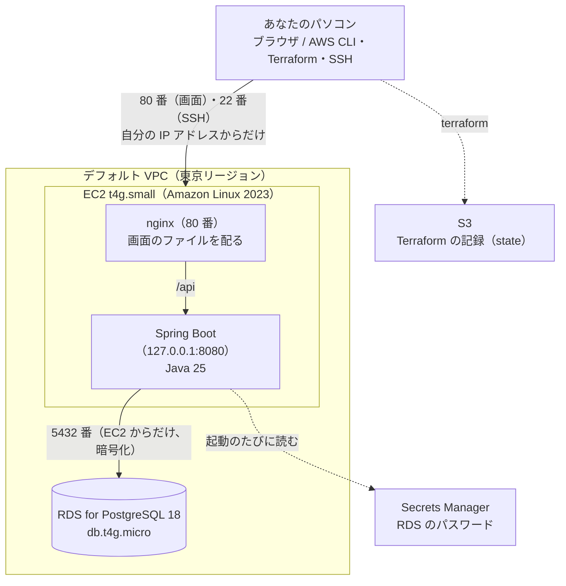

# AWS × Terraform デプロイガイド（taskmanegemento）

作成日：2026-10-27　更新日：2026-10-30

## はじめに

このガイドは、taskmanegemento を AWS の上で動かすための、構成・準備・デプロイ・日々の運用をまとめたものです。AWS も Terraform もはじめての人を読者として、用語の意味から説明します。

AWS の部品は Terraform のコード（`infra`）で作り、アプリは PowerShell のスクリプト（`deploy`）で載せます。マネジメントコンソール（AWS の Web 画面）は、アカウントを作る・ルートユーザーを守る・予算を設定する、の 3 つだけで使います。

| 読むもの | 書いてあること |
| --- | --- |
| このガイド | 全体の構成、考え方、準備、運用 |
| [infra/README.md](../infra/README.md) | Terraform のファイルごとの中身と、作る・片付けるコマンド |
| [deploy/ec2/README.md](../deploy/ec2/README.md) | デプロイ、前の版に戻す、動作の確認のくわしい手順 |

このアプリは自分だけが使うスクールの課題なので、仕事の Web アプリより軽い構成にしています。アプリを開けるのは、自分のパソコンの IP アドレスからだけです。

## 1. 今の構成



| 部品 | 中身 | 作り方 |
| --- | --- | --- |
| EC2 | t4g.small（Arm、メモリ 2GB）、ディスク 20GB。Java 25（Amazon Corretto 25）と nginx を直接入れる | Terraform（`infra/compute.tf`、`infra/user_data.sh`） |
| EC2 のセキュリティグループ | 22 番（SSH）と 80 番（画面）を、自分の IP アドレスからだけ通す | Terraform（`infra/network.tf`） |
| nginx | 画面のファイルを配り、`/api` を Spring Boot へ取り次ぐ。パソコンでの Vite と同じ役目 | `deploy/ec2/nginx.conf` |
| Spring Boot | systemd で動かす。専用のユーザー `taskmanagement` で動き、EC2 の中（127.0.0.1）からだけ受け付ける | `deploy/ec2/start.sh`、`taskmanagement.service` |
| RDS | PostgreSQL 18.6、db.t4g.micro、ディスク 20GB、暗号化あり。インターネットからは入れない | Terraform（`infra/database.tf`） |
| RDS のセキュリティグループ | 5432 番を、EC2 のセキュリティグループからだけ通す | Terraform（`infra/database.tf`） |
| RDS のパスワード | RDS が作って Secrets Manager に置き、7 日ごとに自動で変える。Terraform の記録にもリポジトリにも残らない | Terraform（`manage_master_user_password`） |
| EC2 の権限（IAM ロール） | RDS のパスワードを読むことだけを許す | Terraform（`infra/iam.tf`） |
| Terraform の記録（state） | S3 バケット `taskmanagement-tfstate-<アカウント番号>` | AWS CLI（[5-2](#5-2-state-の置き場所を作る)） |

パソコンと EC2 での違いは、次のとおりです。アプリのコードと設定ファイルは、どちらでも同じものを使います。

| | パソコン（開発） | EC2 |
| --- | --- | --- |
| 画面 | Vite が 5173 番で配る | `npm run build` で作ったファイルを、nginx が 80 番で配る |
| `/api` の取り次ぎ | Vite のプロキシ | nginx |
| Spring Boot | `127.0.0.1` の 8080 番 | 同じ |
| データベース | Docker の PostgreSQL（`.env` のパスワード） | RDS（Secrets Manager のパスワード） |

### 1-1 誰が何につながれるか

| どこから | どこへ | 通るか |
| --- | --- | --- |
| 自分のパソコン | EC2 の 80 番（画面と `/api`）、22 番（SSH） | 通る |
| ほかの人のパソコン | EC2 | 通らない（IP アドレスが違う） |
| 自分のパソコン | EC2 の 8080 番（Spring Boot） | 通らない（nginx を通してだけ届く） |
| 自分のパソコン | RDS | 通らない（RDS は公開されておらず、内部の IP アドレスしか持たない） |
| EC2 | RDS の 5432 番 | 通る（RDS に入れるのは EC2 だけ） |

### 1-2 費用の目安

金額はどれも東京リージョンの概算です。今は無料プランのクレジット（100 ドル、2027-04-26 まで）から差し引かれ、カードには請求されません。

| 部品 | 月額の目安（ドル） |
| --- | --- |
| EC2 t4g.small | 0（2026-12-31 までの無料トライアル。その後は約 15） |
| EC2 の公開 IP アドレス | 約 3.6（EC2 を止めているあいだはかからない） |
| EC2 のディスク 20GB | 約 2 |
| RDS db.t4g.micro | 約 18（止めているあいだはかからない） |
| RDS のディスク 20GB | 約 3 |
| Secrets Manager | 約 0.4 |
| S3（Terraform の記録） | ほぼ 0 |
| 合計 | 約 27（2027 年からは約 42） |

使わない日は EC2 と RDS を止めると、ディスクの分（月約 5 ドル）だけになります（[6-4](#6-4-使わない日は止める)）。

## 2. 基礎知識

### 2-1 AWS とは

AWS（Amazon Web Services）は、サーバーやデータベースを「必要なときに、必要なぶんだけ」借りられるサービスです。このような仕組みを**クラウド**といいます。自分でサーバーの機械を買う代わりに、時間や量に応じて利用料を払います。

このアプリで使っている AWS の部品（サービス）は、次のとおりです。

| サービス | ひとことで言うと | このアプリでの役目 |
| --- | --- | --- |
| IAM | 「誰が、何をしてよいか」を決める仕組み | あなた、Terraform、EC2 が AWS を操作するための許可 |
| リージョン | AWS のデータセンターがある地域 | 東京（`ap-northeast-1`）を使う |
| VPC | AWS の中の、自分専用のネットワーク | アカウントに最初からある「デフォルト VPC」をそのまま使う |
| セキュリティグループ | 部品ごとの門番（ファイアウォール） | EC2 と RDS に、通してよい通信だけを決める |
| EC2 | 仮想のサーバー（パソコン）を借りるサービス | nginx と Spring Boot を動かす |
| RDS | AWS が管理してくれるデータベース | PostgreSQL を動かす。パソコンの Docker の PostgreSQL の代わり |
| Secrets Manager | パスワードなどの秘密の置き場 | RDS のパスワードを置く。パソコンの `.env` の代わり |
| S3 | ファイル置き場 | Terraform の記録（state）を置く |
| AWS Budgets | 予算と請求の見張り | 使いすぎたときにメールで知らせる |

### 2-2 IaC と Terraform とは

**IaC**（Infrastructure as Code）は、サーバーやネットワークの構成を「コードとしてファイルに書く」やり方です。画面をクリックして作ると、何をどう設定したかが記憶にしか残りません。コードにしておくと、次のような良いことがあります。

- **同じものを何度でも作れる**：消しても、コマンド 1 つで元どおりに作り直せる
- **変更の履歴が Git に残る**：アプリのコードと同じく、イシュー → ブランチ → プルリクエストでレビューできる
- **AI と相性がいい**：Claude Code がファイルを書き、あなたが差分を読んで確かめる、という分担ができる

**Terraform** は、HashiCorp 社が作った IaC の道具です。`.tf` というファイルに「こういう状態にしてほしい」を書くと、Terraform が今の状態との差を調べ、足りないものを作り、違うものを直し、余ったものを消します。この書き方を**宣言的**といいます（手順ではなく、ゆきつく先を書く）。

覚えておく言葉は次の 6 つです。

| 言葉 | 意味 |
| --- | --- |
| provider | どのクラウド（ここでは AWS）と話すかを決める部品 |
| resource | 作りたいもの 1 つ（EC2、RDS など） |
| variable / output | 外から渡す値（自分の IP アドレスなど）/ 作った後に表示したい値（URL など） |
| state（ステート） | Terraform が「自分が作ったものの一覧」を記録したファイル。これを失うと、Terraform は自分が作ったものを忘れてしまう |
| backend | state の置き場。このアプリでは S3 に置く |
| plan / apply | 下見 / 実行。plan は何も変えない |

使うコマンドは、ほぼ次の 4 つだけです。

1. `terraform init`：準備。provider をダウンロードし、backend につなぐ
2. `terraform plan`：**下見**。何を作り、変え、消すかを表示するだけで、何も変えない
3. `terraform apply`：**実行**。plan の内容を本当に反映する。`yes` と打つまでは動かない
4. `terraform destroy`：**片付け**。Terraform が作ったものをすべて消す

plan の結果には、`+`（作る）、`~`（その場で変える）、`-`（消す）、`-/+`（消して作り直す）の印がつきます。**`-` と `-/+` が出たら必ず止まって理由を確かめる**、これが一番大事な習慣です。RDS が作り直されると、中のデータは消えます。

### 2-3 AWS CLI と、AI を使った進め方

**AWS CLI** は、AWS をコマンドで操作するための道具です。マネジメントコンソールでできることは、ほぼすべて `aws サービス名 操作名` の形のコマンドでもできます。

```powershell
# 今、自分が誰として AWS につながっているかを表示する
aws sts get-caller-identity
```

AWS CLI と Terraform は、役割を分けて使います。

| 道具 | 使う場面 | 例 |
| --- | --- | --- |
| Terraform | **作って残しておくもの**を作る・変える・消す | EC2、RDS、セキュリティグループ |
| AWS CLI | 状態の確認、止める・動かす | ログインの確認、EC2 や RDS を止める |

Terraform で作ったものを AWS CLI やマネジメントコンソールで直接変えると、Terraform の記録とずれます（これを**ドリフト**といいます）。設定を変えるときは、必ず Terraform のコードを直します。止める・動かすのは、設定を変えないので AWS CLI で行ってかまいません。

Claude Code は、あなたのパソコンの上で、あなたと同じ権限でコマンドを実行します。便利な反面、間違ったコマンドでも実際に動いてしまうので、次のように分担します。

| 作業 | Claude Code | あなた |
| --- | --- | --- |
| `.tf` やスクリプトを書く | 書いて、プルリクエストを作る | 差分を読み、main に取り込む |
| `terraform plan`、状態を見る `aws` コマンド | 実行して結果を説明する | 説明を読む |
| `terraform apply`、`terraform destroy` | 実行の前に許可を求める | plan を確かめて許可する |
| ルートユーザーや支払いの設定 | 触らない | マネジメントコンソールで行う |

## 3. 準備（最初の 1 回だけ）

### 3-1 AWS アカウントを作り、ルートユーザーを守る

ここだけはマネジメントコンソール（ブラウザ）で行います。

**ルートユーザー**とは、アカウントを作ったときのメールアドレスとパスワードのことです。支払いも解約も含めて何でもできるため、盗まれると大きな請求につながります。ふだんの作業には使わず、金庫の鍵のようにしまっておきます。

1. <https://aws.amazon.com/> で「アカウントを作成」を選び、メールアドレス、アカウント名、クレジットカード、電話番号を登録する
2. プランを選ぶ。無料プランは請求が来ないが、6 か月かクレジットを使い切った時点でアカウントが閉じる（[AWS 無料利用枠](https://aws.amazon.com/free/)）
3. ルートユーザーに **MFA（多要素認証）** を登録する（右上のアカウント名 →「セキュリティ認証情報」）
4. 同じ画面で、ルートユーザーの**アクセスキーが 1 つもない**ことを確かめる
5. 「請求とコスト管理」→「Budgets」で、**月額のコスト予算**（月 30 ドルなど）を作り、超えそうなときにメールが届くようにする

### 3-2 パソコンにツールを入れる

PowerShell で次を実行します。`--source winget` を付けるのは、Microsoft Store 側の証明書のエラーで止まることがあるためです。

```powershell
winget install --id Amazon.AWSCLI -e --source winget
winget install --id Hashicorp.Terraform -e --source winget
```

入れたら **Cursor をいったん閉じて開き直し**、`aws --version` と `terraform version` で版の番号が出るか確かめます。Node.js、Java 25、Docker Desktop は、アプリの開発のために入っているものを使います（[技術スタック](技術スタック.md) 3 章）。

**Norton を使っている場合**：Norton の「セーフウェブ」が暗号化された通信を点検していると、AWS CLI は証明書のエラーで止まり、Terraform は「Plugin did not respond」で止まります。セーフウェブの除外に、`amazonaws.com`、`127.0.0.1`、`localhost`、`registry.terraform.io`、`releases.hashicorp.com` を登録してください。

### 3-3 認証（自分のパソコンから AWS を操作できるようにする）

今は、IAM ユーザー `admin-user`（権限は `AdministratorAccess`、MFA あり）のアクセスキーを、`aws configure` で登録して使っています。キーは `C:\Users\<名前>\.aws\credentials` にあります。

```powershell
aws configure                  # アクセスキー、リージョン（ap-northeast-1）、出力形式（json）を登録する
aws sts get-caller-identity    # admin-user と表示されれば、つながっている
```

アクセスキーは**期限のない鍵**で、MFA を通らずに使えます。漏れると、アカウントを自由に使われてしまいます。次のことを守ってください。

- アクセスキーを、リポジトリのファイル、コミット、チャット、スクリーンショットに書かない
- 使わなくなったら、マネジメントコンソールで無効にする

より安全な方法は、**IAM Identity Center** でブラウザからログインし、数時間で切れる一時的な鍵をもらう方式（`aws configure sso`）です。本格的に使う前に切り替え、アクセスキーを消すことをおすすめします。

### 3-4 SSH の鍵を作る

EC2 に入るための鍵を作ります。秘密鍵はパソコンにだけ置き、公開鍵だけを Terraform が AWS に登録します。

```powershell
New-Item -ItemType Directory -Force "$HOME\.ssh" | Out-Null
ssh-keygen -t ed25519 -f "$HOME\.ssh\taskmanagement-ec2" -C "taskmanagement-ec2"
```

パスフレーズを聞かれたら、何も入れずに Enter を 2 回押します。

## 4. 作った流れ

一度に全部作らず、段に分けて、1 段ずつ動きを確かめてから次へ進みました。どの段も、`CLAUDE.md` の「イシュー → ブランチ → プルリクエスト」の流れで行っています。

| 段 | 作ったもの | 確かめたこと | イシュー |
| --- | --- | --- | --- |
| 1 | Terraform の土台と EC2 | SSH で入れる。Java 25 が入っている | #41 |
| 2 | nginx と 80 番 | ブラウザで nginx の初期画面が出る | #43 |
| 3 | RDS | EC2 からつながる。パソコンからはつながらない | #45 |
| 4 | Spring Boot を EC2 で動かし、RDS につなぐ | EC2 の中から `/api/board` が答える。Flyway がテーブルを作った | #47 |
| 5 | nginx で画面を配り、`/api` を取り次ぐ | ブラウザからカードを追加・保存・削除できる | #49 |
| 6 | `deploy/deploy.ps1` | コマンド 1 つでデプロイできる | #51 |
| 7 | 失敗したら前の版に戻す | 動かない版を載せると自動で戻る。`-Rollback` で手で戻せる | #53 |
| 8 | `deploy/smoke-test.ps1` | デプロイのあと、カードの操作まで自動で確かめる | #55 |
| 9 | このガイドの書き直し | | #57 |

## 5. 一から作るとき

AWS の上に何もない状態から、アプリが使えるところまでの手順です。コマンドは、リポジトリの一番上のフォルダで、PowerShell 7 で実行します。

### 5-1 流れ

1. 準備（3 章）が終わっていることを確かめる
2. state の置き場所を作る（5-2）
3. 自分の IP アドレスを `infra/terraform.tfvars` に書く（5-3）
4. `terraform init`、`plan`、`apply` で EC2 と RDS を作る（5-4）。RDS ができるまで 10 分ほどかかる
5. `.\deploy\deploy.ps1` でアプリを載せる（6-1）

### 5-2 state の置き場所を作る

Terraform の記録（state）は、パソコンが壊れても失わないように S3 に置きます。このバケットは Terraform 自身の記録を入れる場所なので、Terraform より先に AWS CLI で作ります。

```powershell
$account = aws sts get-caller-identity --query Account --output text
$bucket = "taskmanagement-tfstate-$account"

# バケットを作る
aws s3api create-bucket --bucket $bucket --region ap-northeast-1 --create-bucket-configuration LocationConstraint=ap-northeast-1

# 上書きしても前の版に戻せるようにする
aws s3api put-bucket-versioning --bucket $bucket --versioning-configuration Status=Enabled

# インターネットに公開されないようにする
aws s3api put-public-access-block --bucket $bucket --public-access-block-configuration BlockPublicAcls=true,IgnorePublicAcls=true,BlockPublicPolicy=true,RestrictPublicBuckets=true
```

リポジトリは公開なので、バケット名（アカウント番号を含む）はコードに書かず、`terraform init` のときに渡します（`infra/versions.tf`）。

### 5-3 自分の IP アドレスを書く

`infra/terraform.tfvars.example` を `infra/terraform.tfvars` にコピーし、`my_ip` を今の IP アドレスに書き換えます。`terraform.tfvars` は Git に入りません。

```powershell
(Invoke-RestMethod https://checkip.amazonaws.com).Trim()   # 今の IP アドレスを調べる
```

### 5-4 Terraform で作る

```powershell
$account = aws sts get-caller-identity --query Account --output text
terraform -chdir=infra init -backend-config="bucket=taskmanagement-tfstate-$account"
terraform -chdir=infra plan
terraform -chdir=infra apply
```

`apply` が終わると、`app_url`（ブラウザで開く URL）、`ssh_command`（SSH で入るコマンド）、`db_endpoint`（RDS の接続先）などが表示されます。あとで見るときは `terraform -chdir=infra output` で表示できます。

EC2 は、起動してから数分かけて Java 25 と nginx を入れます。終わったかどうかは、SSH で入って `cloud-init status` が `done` になっているかで分かります。

## 6. 日々の運用

### 6-1 デプロイする

機能を main に取り込んだあと、main で実行します。Docker Desktop を動かしておきます（サーバーのテストで使う）。

```powershell
git switch main
git pull

.\deploy\deploy.ps1            # 画面とサーバーの両方
.\deploy\deploy.ps1 -Frontend  # 画面だけ変えたとき（アプリは止まらない）
.\deploy\deploy.ps1 -Backend   # サーバーだけ変えたとき（10 秒ほど止まる）
```

`deploy.ps1` は、事前の確認 → 点検とビルド（テストを含む）→ EC2 に送る → 入れ替える → 動作の確認、の順に進み、どこかで失敗したらそこで止まります。くわしくは [deploy/ec2/README.md](../deploy/ec2/README.md) にあります。

### 6-2 前の版に戻す

入れ替えたものが動かなければ、`deploy.ps1` が自動で前の版に戻し、「前の版に戻しました」と表示して止まります。デプロイは通ったが触ったらおかしい、というときは、手で戻します。

```powershell
.\deploy\deploy.ps1 -Rollback   # -Frontend、-Backend で片方だけ
```

もう一度 `-Rollback` すると、戻す前の版になります。戻せるのは 1 つ前の版までで、データベースの中身は戻りません。

### 6-3 動いているか確かめる

デプロイの最後に `deploy/smoke-test.ps1` が自動で動き、画面とカードの追加・編集・移動・削除を確かめます。単独でも動かせます。

```powershell
.\deploy\smoke-test.ps1
```

画面の動き（ドラッグ＆ドロップなど）は、[deploy/ec2/README.md](../deploy/ec2/README.md) の一覧にそって、ブラウザで触って確かめます。

### 6-4 使わない日は止める

```powershell
$id = terraform -chdir=infra output -raw instance_id

# 止める
aws ec2 stop-instances --instance-ids $id
aws rds stop-db-instance --db-instance-identifier taskmanagement-db

# また動かす（RDS が先。動き出すまで数分かかる）
aws rds start-db-instance --db-instance-identifier taskmanagement-db
aws ec2 start-instances --instance-ids $id

# 動かしたあと、Terraform の記録を新しくする（公開 IP アドレスが変わるため）
terraform -chdir=infra apply -refresh-only
terraform -chdir=infra output app_url
```

- **EC2 は、動かすたびに公開 IP アドレスが変わります。** `deploy.ps1` と `smoke-test.ps1` は Terraform の記録から IP アドレスを読むので、動かしたあとは必ず `terraform apply -refresh-only` を実行します。これは記録を新しくするだけで、AWS の上のものは何も変えません（`yes` と打つと記録が更新される）
- RDS は、止めても 7 日たつと自動で動き出します。長く使わないときは片付けます（6-8）
- EC2 の中の nginx と Spring Boot は、EC2 を動かすと自動で動き出します。RDS がまだ動いていないと Spring Boot は起動に失敗しますが、10 秒ごとに起動し直すので、RDS が動けばつながります

### 6-5 自宅の IP アドレスが変わったとき

ルーターの再起動などで、自宅の IP アドレスが変わることがあります。急に画面や SSH がつながらなくなったら、今の IP アドレスを調べて `infra/terraform.tfvars` の `my_ip` を直し、反映します。

```powershell
(Invoke-RestMethod https://checkip.amazonaws.com).Trim()
terraform -chdir=infra plan    # セキュリティグループのルールだけが変わることを確かめる
terraform -chdir=infra apply
```

### 6-6 RDS のパスワードが変わったとき

RDS のパスワードは、RDS が 7 日ごとに自動で変えます。Spring Boot は起動したときにパスワードを読むので、変わったあとに新しくつなぐと失敗し、画面でカードを読み込めなくなります。そのときは、Spring Boot を起動し直します。

```powershell
ssh -i ~/.ssh/taskmanagement-ec2 "ec2-user@$(terraform -chdir=infra output -raw public_ip)" "sudo systemctl restart taskmanagement"
```

### 6-7 データを残す（バックアップ）

RDS の中身を、SQL のファイルとしてパソコンに残します。EC2 に SSH で入って書き出し、パソコンに持ってきます。

```bash
# EC2 の中で（psql と pg_dump がなければ、先に sudo dnf install -y postgresql18）
source /opt/taskmanagement/app.env
export PGPASSWORD=$(aws secretsmanager get-secret-value --region ap-northeast-1 --secret-id "$DB_SECRET_ARN" --query SecretString --output text | python3 -c 'import json,sys; print(json.load(sys.stdin)["password"])')
pg_dump "host=$DB_HOST dbname=taskmanagement user=taskmanagement sslmode=require" > ~/taskmanagement-backup.sql
unset PGPASSWORD
```

```powershell
# パソコンで。リポジトリの外（ドキュメントなど）に置く
scp -i ~/.ssh/taskmanagement-ec2 "ec2-user@$(terraform -chdir=infra output -raw public_ip):taskmanagement-backup.sql" "$HOME\Documents\taskmanagement-backup.sql"
```

戻すときは、RDS を作り直した直後、アプリを載せる前に、同じようにファイルを EC2 に送って `psql "host=$DB_HOST dbname=taskmanagement user=taskmanagement sslmode=require" -f ~/taskmanagement-backup.sql` で流します。そのあとアプリを載せると、Flyway は記録を見て、テーブルを作り直さずに起動します。

### 6-8 片付ける

課題が終わったら、費用を止めるために全部消します。**RDS の中身は消え、戻せません。** 残したいときは、先にバックアップを取ります（6-7）。

```powershell
terraform -chdir=infra plan -destroy   # 消すものを確かめる
terraform -chdir=infra destroy
```

state の置き場所（S3 バケット）は Terraform の外で作ったので、`destroy` では消えません。費用は月に 1 円にも満たないので、続けて使うなら残しておきます。パソコンの SSH の鍵と `infra/terraform.tfvars` も残ります。

## 7. 安全のための約束と、Claude Code への頼み方

### 7-1 守ること

- パスワード、アクセスキー、秘密鍵を、リポジトリのファイル、コミット、イシュー、プルリクエストに書かない。リポジトリは公開なので、アカウント番号や IP アドレスも書かない
- `terraform apply` と `terraform destroy` は、plan を自分の目で確かめてから許可する。plan に `-` か `-/+` が出たら、止まって理由を聞く
- Terraform で作ったものの設定を、マネジメントコンソールや AWS CLI で直接変えない
- デプロイは main から `deploy.ps1` で行う。`-SkipGitCheck` は、動作確認のときだけ使う
- 使わない日は止め、課題が終わったら片付ける。予算のメールが来たら、まず止める
- `infra/tfplan`（plan を保存したファイル）を作ったときは、コミットしない

### 7-2 Claude Code への頼み方の例

| やりたいこと | 頼み方 |
| --- | --- |
| デプロイする | 「main を最新にして、`deploy.ps1` で両方デプロイして」 |
| 状態を確かめる | 「EC2 と RDS が動いているか見て。変更はしないで」 |
| 止める・動かす | 「EC2 と RDS を止めて」「動かして、Terraform の記録も新しくして」 |
| エラーを調べる | 「画面が出ない。Spring Boot のログと nginx の状態を見て、原因を説明して」 |
| 設定を変える | 「RDS のバックアップの保存期間を延ばしたい。イシューから作って、plan まで進めて」 |
| 請求を確かめる | 「今月ここまでの AWS の利用料を、サービスごとに見せて」 |
| 片付ける | 「`terraform destroy` の plan を見せて」 |

## 8. 用語集

| 言葉 | 意味 |
| --- | --- |
| デプロイ | 作ったアプリを、利用者が使える場所に置いて動かすこと |
| アクセスキー | AWS に「自分が誰か」を示す、期限のない鍵 |
| セキュリティグループ | AWS の部品ごとの門番。通してよい通信（番地と相手）を決める。相手は IP アドレスでも、別のセキュリティグループ（「その門番がついているもの」）でも指定できる |
| SSH | 別のコンピューターに安全に入って、コマンドを打つ仕組み。鍵（秘密鍵と公開鍵）で本人を確かめる |
| nginx | Web サーバー。ファイルを配ったり、通信を別のプログラムへ取り次いだりする |
| systemd | Linux で、プログラムを常に動かしておく仕組み。落ちたら起動し直し、サーバーを起動し直したときも自動で動かす |
| user data | EC2 が初めて起動したときに 1 回だけ動く手順（`infra/user_data.sh`） |
| Flyway | データベースのテーブルを、番号つきの SQL のファイルで作る・変える道具。Spring Boot の起動のときに動く |
| ロールバック | 前の版に戻すこと |
| スモークテスト | デプロイのあとに、大事なところだけ手早く確かめるテスト |
| ドリフト | Terraform の記録と、AWS の上の実際の状態がずれていること |

## 参考にしたページ

- [AWS 無料利用枠](https://aws.amazon.com/free/)（クレジットと無料プランの条件）
- [Amazon EC2 T4g](https://aws.amazon.com/ec2/instance-types/t4/)（t4g.small の無料トライアル）
- [Terraform の S3 backend](https://developer.hashicorp.com/terraform/language/backend/s3)（state の置き場と鍵のかけ方）
- [Amazon Corretto 25 の入れ方（Amazon Linux 2023）](https://docs.aws.amazon.com/corretto/latest/corretto-25-ug/amazon-linux-install.html)
- [AWS Pricing Calculator](https://calculator.aws/)（費用の見積もり）
